# TamaNaruto

  

Ein **Ninja-Tamagotchi** für das **Waveshare ESP32-S3-Touch-AMOLED-1.75**: rundes 466×466-AMOLED, Touch, Akku, Lautsprecher.
Du ziehst einen Ninja aus Konoha, Suna, Kiri oder Oto groß, gehst auf **Missionen**, wirbst besiegte Ninja an und stellst dich der **Chunin-Prüfung**.

> **Herkunft:** TamaNaruto basiert auf der TamaPoke-Engine (Original von **Quique Tortosa** – [socquique/TamaPoke](https://github.com/socquique/TamaPoke), Forks von [DylanPDao](https://github.com/DylanPDao/TamaPoke) und [eperdeme](https://github.com/eperdeme/TamaPoke)) und deren Digimon-Ableger [TamaDigi](https://github.com/joop0810/TamaDigi). Display, Touch, Sound, Speicherstände, Kampfsystem, Emulator und Web-Installer stammen von dort.
>
> **Nicht-kommerzielles Fan-Projekt.** Der Code steht unter MIT. Naruto, alle Namen und die Pixelgrafiken (aus *Naruto: Ninja Council 1 & 2*, GBA) sind © Masashi Kishimoto / Shueisha / Bandai. Siehe [CREDITS.md](CREDITS.md).

## Bildschirme

Alle Bilder stammen direkt aus dem Emulator (`bash tools/make_screens.sh`) und zeigen genau das, was das Display zeichnet.

| Dein Ninja | Akademie-Rolle | Dorf wählen |
|---|---|---|
| 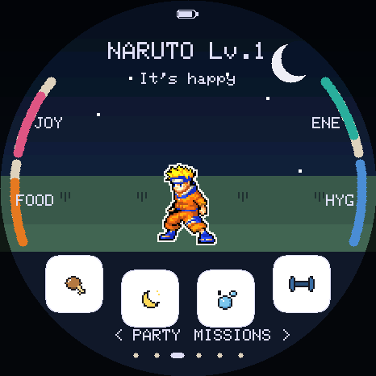 | 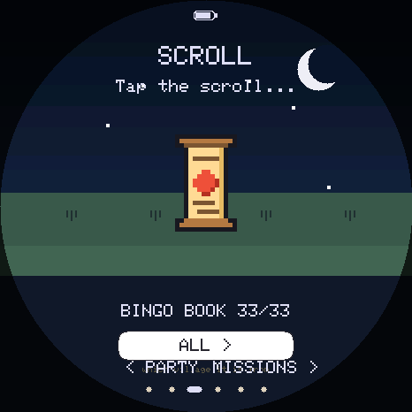 | 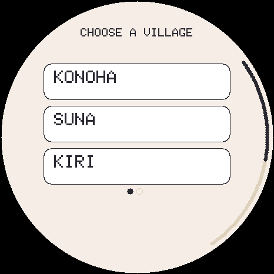 |

| Kampf | Jutsu wählen | Mission | Missionen |
|---|---|---|---|
| 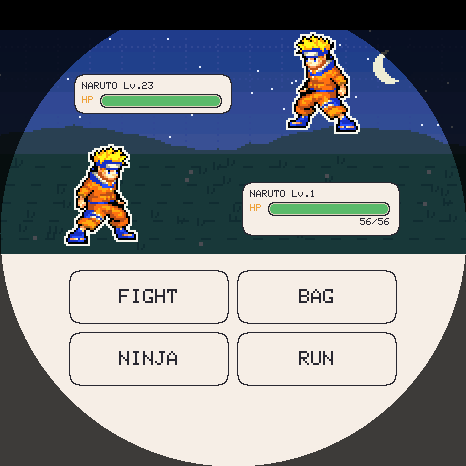 | 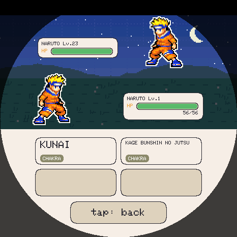 | 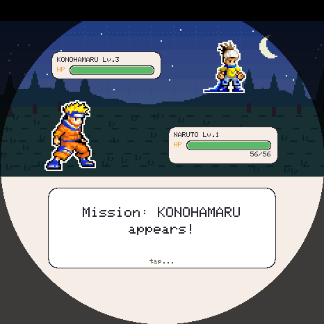 | 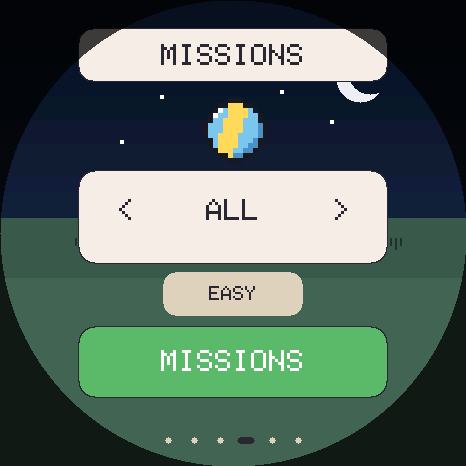 |

| Chunin-Prüfung | Suna-Prüfung | Sieg | Team wählen |
|---|---|---|---|
| 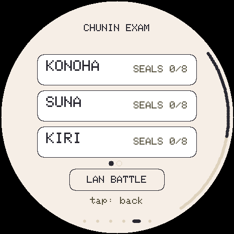 | 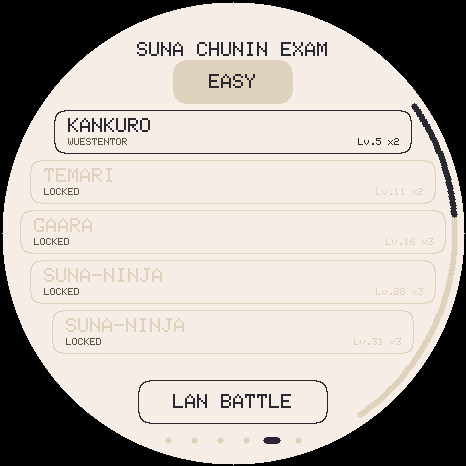 | 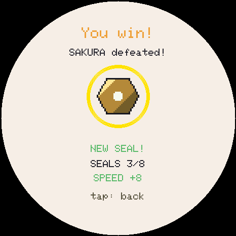 | 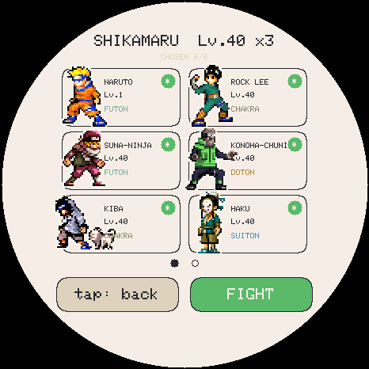 |

| Bingo-Buch | Konoha | Suna | Box |
|---|---|---|---|
| 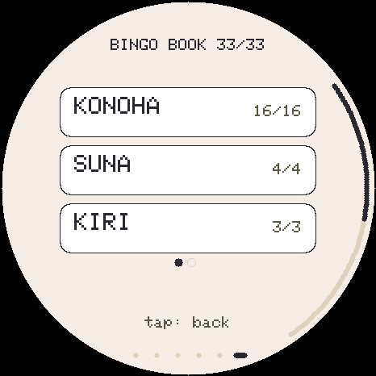 | 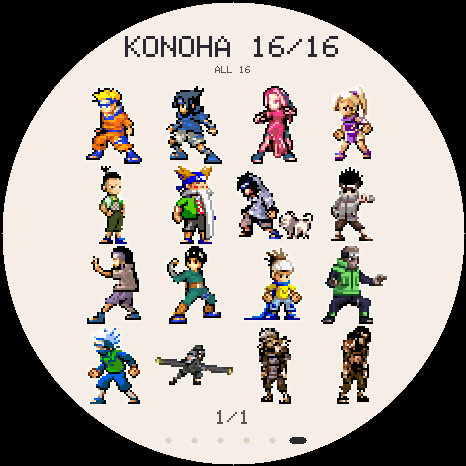 | 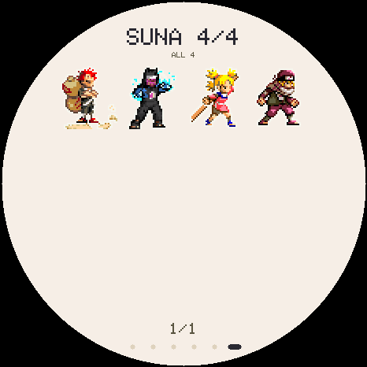 | 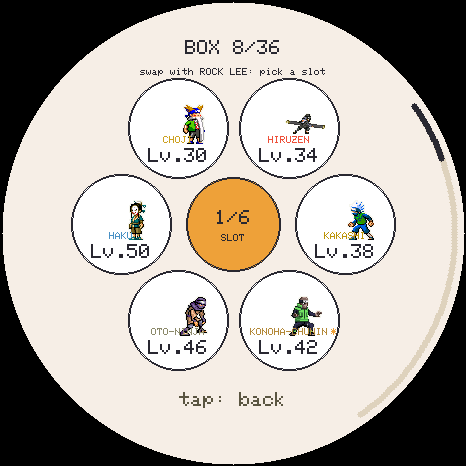 |

| Sensei-Karte | Siegel | Jutsu | LAN-Kampf |
|---|---|---|---|
| 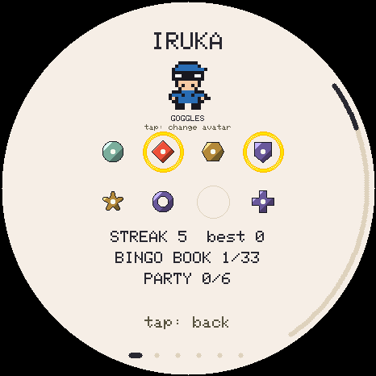 | 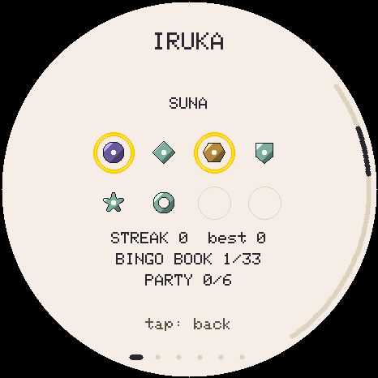 | 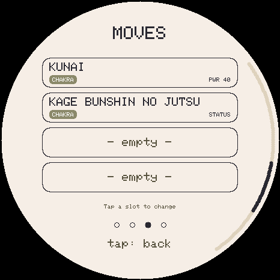 | 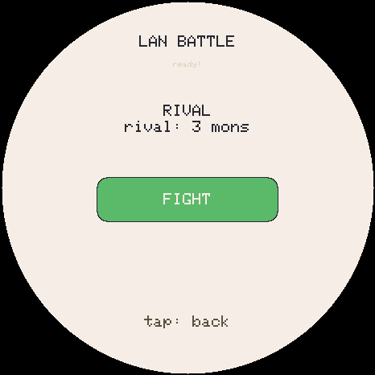 |

## Wie das Spiel funktioniert

- **Ränge statt Entwicklung:** Jeder Ninja behält seinen Rang aus der Serie, Naruto ist Genin, Kakashi Jonin, Hiruzen Kage. Niemand verwandelt sich in jemand anderen. Was wächst, ist das Level (eins pro Stunde) und damit die Werte und Jutsu.
- **Akademie-Rolle:** Statt eines Eis wartet eine Schriftrolle. Beim ersten Start wählst du dein Dorf und in Konoha, Suna und Oto einen von drei Genin, z. B. **Naruto, Sasuke oder Sakura**. Spätere Rollen sind Überraschungen: Genin häufig, Chunin selten, Jonin und Kage legendär.
- **Pflege:** Füttern (**Ramen, Dango, Onigiri**), Licht aus, Baden, Training. Nach drei Tagen kann sich dein Ninja verabschieden und kommt ins Team.
- **Missionen:** Die Gegner richten sich nach deinem Level, Genin zuerst, Chunin ab Level 25, Jonin ab 49, Kage ab 61. Schwäch sie und setz eine **Schriftrolle** ein, um sie anzuwerben (Schriftrolle, Silber-, Gold- und Kage-Rolle).
- **Chunin-Prüfung:** je Dorf acht Runden, vier Elite-Kämpfe und ein Finale, auf Leicht und Schwer. Wie in der echten Prüfung treten Ninja aus allen Dörfern an. Für jede Runde gibt es ein **Siegel**.
- **Kampf:** rundenbasiert mit vier Jutsu (Rasengan, Chidori, Kagemane, Hakke 64 …).
  - **Chakra-Naturen:** Katon > Futon > Raiton > Doton > Suiton > Katon (×2 / ×½), Mokuton schlägt Suiton und Doton, Yin und Yang schlagen einander.
  - **Kampfstil:** Taijutsu schlägt Genjutsu, Genjutsu schlägt Ninjutsu, Ninjutsu schlägt Taijutsu (×1,3 / ×0,8).
- **Bingo-Buch:** alle Ninja, die du schon aufgezogen oder getroffen hast.
- **LAN-Kampf** zwischen zwei Geräten per ESP-NOW.

## Die Dörfer

| Dorf | Ninja |
|---|---|
| **Konoha** (16) | Naruto, Sasuke, Sakura, Ino, Shikamaru, Choji, Kiba, Shino, Neji, Rock Lee, Konohamaru, ein Konoha-Chunin, Kakashi, Hiruzen, Tobirama, Hashirama |
| **Suna** (4) | Gaara, Kankuro, Temari, ein Suna-Ninja |
| **Kiri** (3) | Haku, ein Kiri-Ninja, Zabuza |
| **Oto** (10) | Dosu, Zaku, fünf Oto-Ninja, der Oto-Koloss, Kabuto, Orochimaru |

Alles steht in einer Datei: [`tools/game_data.py`](tools/game_data.py) (Kader, Ränge, Naturen, Jutsu, Prüfungen).

## Hardware

- [Waveshare ESP32-S3-Touch-AMOLED-1.75](https://www.waveshare.com/wiki/ESP32-S3-Touch-AMOLED-1.75): die **Standard**- oder **-G**-Version, **nicht „-B“**
- 466×466 AMOLED (CO5300, QSPI), Touch CST9217, AXP2101 (Akku/PWR), PCF85063 (RTC), microSD, ES8311 (Sound)
- microSD-Karte im Slot (die Sprites liegen dort)

## Installation

### Variante A: Web-Installer (empfohlen, nichts installieren)

1. **https://joop0810.github.io/tamaruto/web/** in **Chrome oder Edge** öffnen (Firefox und Safari können kein Web Serial).
2. Board per USB-C anstecken, **Install firmware** klicken und den Port wählen.
3. Weiter unten die **Dorf-Packs** (Sprites) auf die SD-Karte senden: Konoha, Suna, Kiri, Oto, einzeln oder alle.
4. Fertig. Sprache am Gerät: Namen antippen → SETTINGS → Sprachzeile antippen (bis „DE“).

**Eigener Fork:** Repo forken, in `web/editions.json`, `web/index.html` und `web/installer.js` `joop0810` durch deinen GitHub-Namen ersetzen, unter **Settings → Pages → Source** „GitHub Actions“ wählen und auf `main` pushen. Der Workflow kompiliert die Firmware in der Cloud und veröffentlicht deinen eigenen Installer.

### Variante B: `start.bat` (Windows, lokal)

Doppelklick auf **`start.bat`**. Das Skript lädt die zuletzt von GitHub gebaute Firmware (oder nimmt `tamanaruto-firmware.zip` aus dem Download-Ordner, zu finden unter **GitHub → Actions → letzter Lauf → Artifacts**). Danach öffnet es den Installer unter `http://localhost:8765/web/` in Chrome oder Edge. Du brauchst weder Python noch Arduino.

### Variante C: Arduino lokal

- Board: **ESP32S3 Dev Module** · Flash **16MB** · PSRAM **OPI PSRAM** · Partition Scheme **16M Flash (3MB APP/9MB FATFS)** · USB CDC On Boot **Enabled**
- Bibliotheken: GFX Library for Arduino 1.6.7, SensorLib 0.4.1, XPowersLib 0.3.3, ESP32-Core 3.3.11

```bash
FQBN="esp32:esp32:esp32s3:CDCOnBoot=cdc,FlashSize=16M,PSRAM=opi,PartitionScheme=app3M_fat9M_16MB"
arduino-cli compile --fqbn "$FQBN" .
arduino-cli upload -p COM5 --fqbn "$FQBN" .
python3 tools/unpack_bundle.py   # Sprites aus web/sprites-*.pak auspacken
python3 tools/send_sd.py         # und per USB auf die SD schicken
```

## Sprites

Die Ninja stammen aus den Sprite-Blättern von **Naruto: Ninja Council 1 und 2** (Game Boy Advance), wie sie [The Spriters Resource](https://www.spriters-resource.com/game_boy_advance/narutonc/) sammelt (gerippt von Deekman u. a.). Die fertigen Packs liegen in `web/sprites-<dorf>.pak`. Zum Spielen brauchst du die Blätter nicht.

Nur wer die Grafik ändern will, legt die Blätter nach `tools/sprites_src/nc1/` bzw. `nc2/` (Dateiname wie auf der Seite, z. B. `naruto.gif`) und baut neu:

```bash
python3 tools/pack_sprites.py --sheet   # schneidet die Blätter, schreibt tools/sdcard/mons/*.bin
python3 tools/make_thumbs.py            # Bingo-Buch-Miniaturen
python3 tools/pack_bundle.py            # web/sprites-<dorf>.pak für den Installer
```

Die Blätter sind frei angeordnet. `tools/sprites/segment.py` schneidet sie in Einzelbilder, `tools/sprites/picks.json` legt fest, welches Bild Stand, Laufen, Angriff, Treffer, Liegen und Jubel ist. `--sheet` schreibt eine Übersicht nach `tools/sprites/check.png`.

## So spielst du

- **Unten**: Füttern (Ramen/Dango/Onigiri) · Licht/Schlafen · Baden · Training (Boxsack → Stärke, Reaktion → Tempo, Ball → Abwehr, Gedächtnisspiel → Freude)
- **Wischen**: horizontal durch `SENSEI · TEAM · [NINJA] · MISSIONEN · CHUNIN-PRÜFUNG · BINGO-BUCH`, hoch = Statuskarte, runter = zurück, am Rand ziehen = blättern
- **Name antippen** = Menü (Beutel, Einstellungen, Verabschieden); **Ninja antippen** = streicheln; **3 s halten** = freilassen
- **Nachts** (0–6 Uhr, Bildschirm aus) schläft dein Ninja von selbst. Dafür muss die Uhrzeit in den Einstellungen gestellt sein.
- **PWR kurz** = Bildschirm an/aus, **lang (4 s)** = ausschalten (die Uhr läuft weiter)
- Sprache: Englisch (Standard), **Deutsch**, Spanisch, Französisch, Italienisch, Portugiesisch

## Am PC ausprobieren: Emulator

`tools/emu/` übersetzt die **echte Firmware** in ein Desktop-Programm, nur die Hardware wird nachgebildet.

```bash
sudo apt install libsdl2-dev          # macOS: brew install sdl2
python3 tools/unpack_bundle.py
bash tools/emu/build.sh
tools/emu/tamanaruto-emu --scale 2 --fast 60
```

## Tests

```bash
TAMA_TEST_BACKEND=host bash tools/emu/tests/run.sh         # alle 48 Suiten im Emulator
TAMA_TEST_BACKEND=host bash tools/emu/tests/run.sh ranks   # nur eine
```

Darunter `ranks_test` (feste Ränge, niemand verwandelt sich, ein Genin erreicht trotzdem seinen Abschied, Missionen nach Level), Kampf, Speichern bei Stromausfall, Web-Installer und Touch. GitHub Actions führt sie bei jedem Push aus und kompiliert dabei die echte ESP32-Firmware.

## Serielle Konsole (115200)

`STATS` · `SPEC <dex>` · `LVL <n>` · `TR <atk> <def> <spe>` · `HATCH` · `EGG <dex>` · `VARIANT` · `WILD` · `BATTLE <dex> <lvl>` · `BYE` · `RUN` · `WIPE` · `EXPORT` / `IMPORT` (Spielstand sichern) · `LS` / `PUT` (SD-Dateien)

## Lizenz

- **Code** (Firmware + Tools): MIT, © 2026 Quique Tortosa und Mitwirkende, Naruto-Umbau © 2026 joop0810.
- **Naruto, Namen, Sprites**: © Masashi Kishimoto / Shueisha / Bandai (Spiel: *Naruto: Ninja Council*). Nur private, nicht-kommerzielle Nutzung.
- **Musik, Siegel, Avatare, Kampfhintergründe, UI-Icons**: in diesem Projekt erzeugt (siehe `tools/gen_music.py`, `gen_ladders.py`, `gen_avatars.py`, `draw_backs.py`, `sprites.py`), MIT.

Inoffizielles Fan-Projekt. Nicht mit Shueisha, Bandai, Studio Pierrot oder TV Tokyo verbunden oder von ihnen unterstützt.
